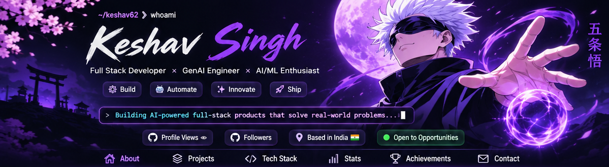

<!-- Anime-inspired hero banner: add anime-hero-banner.png to an assets/ folder in this profile repository -->

<a href="#about-me">About</a> •
<a href="#what-i-work-on">Focus</a> •
<a href="#featured-projects">Projects</a> •
<a href="#tech-stack">Tech Stack</a> •
<a href="#github-dashboard">GitHub</a> •
<a href="#connect-with-me">Contact</a>

About Me
Hey! I'm Keshav Singh, a developer interested in building useful, scalable software at the intersection of full-stack engineering, AI/ML, and Generative AI.

I enjoy taking an idea from problem discovery to a working product — designing APIs, building interfaces, integrating data and AI systems, and improving the experience through testing and iteration.
- Building full-stack applications and AI-powered products.
- Exploring LLM applications, retrieval-augmented generation (RAG), and agentic workflows.
- Interested in machine learning, data-driven systems, and backend architecture.
- Practising data structures, algorithms, and problem solving.
const keshav = {
  role: "Full Stack Developer",
  interests: ["AI/ML", "Generative AI", "Backend Engineering", "System Design"],
  focus: ["LLMs", "RAG", "AI Agents", "Machine Learning"],
  tools: ["React", "Next.js", "Node.js", "Express", "Python", "FastAPI"],
  mindset: "Build. Learn. Improve. Repeat."
};
What I Work On
<table>
  <tr>
    <td width="50%" valign="top">
      <h3>🌐 Full-Stack Development</h3>
      Building responsive applications, REST APIs, authentication flows, database-backed platforms, and real-time experiences.
    </td>
    <td width="50%" valign="top">
      <h3>🤖 Generative AI & Agents</h3>
      Creating LLM-powered applications with RAG, tool calling, multi-agent workflows, and research automation.
    </td>
  </tr>
  <tr>
    <td width="50%" valign="top">
      <h3>📊 Machine Learning</h3>
      Exploring data processing, feature engineering, anomaly detection, and analytical systems.
    </td>
    <td width="50%" valign="top">
      <h3>⚙️ Engineering</h3>
      Working with API design, relational data models, access control, testing, debugging, and system design.
    </td>
  </tr>
</table>Featured Projects
A selection of projects across AI, machine learning, and full-stack engineering.
<table>
  <tr>
    <td width="50%" valign="top">
      <h3>🏛️ MPLADS Drishti</h3>
      
Project monitoring and risk-intelligence platform for development projects. Includes analytics, anomaly detection, investigation workflows, role-based access, and AI-assisted reporting.

      
React · Node.js · FastAPI · Scikit-learn · Supabase · Prisma

      <a href="https://github.com/keshav62/mplads_ai">Repository</a> ·
      <a href="https://github.com/keshav62/SIH2026_techhustlers">SIH project</a>
    </td>
    <td width="50%" valign="top">
      <h3>🔬 ResearchHive AI</h3>
      
Multi-agent research system where specialised agents search, investigate, critique, and compile research into a structured report.

      
Python · FastAPI · LangGraph · LangChain · Tavily · Groq · React

      <a href="https://github.com/keshav62/ResearchHive-AI-A-Multi-Agent-Research-System">Repository</a>
    </td>
  </tr>
  <tr>
    <td width="50%" valign="top">
      <h3>🎓 CourseMate AI</h3>
      
RAG-based study assistant that lets users ask questions about uploaded PDFs and receive answers grounded in their learning material.

      
Python · LangChain · Gemini · ChromaDB · Hugging Face

      <a href="https://github.com/keshav62/CourseMate-AI-Using-RAG">Repository</a>
    </td>
    <td width="50%" valign="top">
      <h3>🧠 Intervue AI</h3>
      
AI interview preparation platform with mock interviews, system-design practice, an AI co-pilot, and progress analytics.

      
Next.js · TypeScript · Gemini · Prisma · PostgreSQL · Stream Video

      <a href="https://github.com/keshav62/AI-Powered-Interview-Platform-">Repository</a>
    </td>
  </tr>
</table>

  
<strong>More AI & SaaS projects</strong>
Project	Description	Stack
MindGPT	AI chat and image-generation SaaS with credits, chat sessions, voice-to-text, and a community gallery	React, Node.js, MongoDB, Gemini, ImageKit, Stripe
Text-to-Image SaaS	Prompt-to-image generation app with credits, plans, and downloads	React, Node.js, MongoDB, Clipdrop
City Intelligence Agent	Tool-using agent for city-related weather, news, and web research	Python, LangChain, Gemini, Tavily

  
<strong>More full-stack projects</strong>
Project	Description	Stack
DoubtBridge	Peer-to-peer academic doubt resolution platform	Next.js, React, Prisma, PostgreSQL
CivicConnect	Civic issue reporting with maps and role-based workflows	React, Node.js, Express
LibraFlow	Library management and digital catalog	Next.js, React, TypeScript, Clerk, Prisma
Learning Management System	Course platform with video lectures, progress tracking, and payments	React, Node.js, MongoDB, Clerk, Stripe
Real-Time Chat	Messaging with presence, typing indicators, and read receipts	React, Socket.IO, MongoDB, JWT
Inventory System	Inventory tracking, reorder alerts, and procurement workflows	Node.js, MongoDB

Tech Stack
Languages

  

Frontend

  

Backend & APIs

  

Databases & ORM

  

AI / ML & GenAI

  
  
  
  
  
  
  
  
  

Tools & Platforms

  

Problem Solving
I regularly practise data structures and algorithms to strengthen my problem-solving and analytical thinking.

800+ problems solved across LeetCode and other practice platforms.

Arrays & Strings · Hashing · Binary Search · Sliding Window · Trees · Heaps · Graphs · BFS / DFS · Dijkstra · Dynamic Programming · Greedy · Segment Trees
Highlights
- 🏆 Hackathon winner.
- 🤖 Built LLM-powered applications and multi-agent workflows.
- 📊 Worked on ML-based risk analysis and anomaly detection.
- ⚡ Built real-time applications using WebSockets / Socket.IO.
- 🧩 Enjoy solving algorithmic problems and learning system design.
Currently Exploring
- Generative AI: RAG evaluation, agentic workflows, tool calling, and multi-agent systems.
- Full Stack: Next.js, TypeScript, API architecture, and production-ready application patterns.
- System Design: Caching, scalability, distributed systems, and reliability.
- Engineering Practices: Docker, testing, observability, and deployment.
GitHub Dashboard

Contribution Snake

<!-- Enable the GitHub Actions workflow described below to generate this SVG. -->

Connect With Me

“Great products are built by staying curious, solving real problems, and improving every day.”

